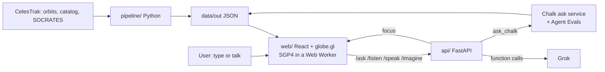

# LVL 500


[ ] **Hook.** One line: what this is, for whom. *(author writes)*

Built at **HackHarvard 2026** (Hack to the Moon) · Track: **ASUS Sustainability: Save the Earth** ·
Challenges: **SpaceX AI "Make It Legendary"**, **Best Data-Driven Agent Built on Chalk** ·
[ ] live link · [ ] demo video (3 min)

[ ] *Hero screenshot of the globe here (`docs/media/hero.png`).*

## The problem
[ ] *(author writes)* Bullets with bold numbers, each with its source. Numbers we can stand behind:
> - About 35,000 tracked objects are in Earth orbit, about 29,000 of them below 2,000 km (CelesTrak SATCAT, Oct 2026).
> - Working satellites crowd 450 to 500 km; tracked debris piles up at 750 to 850 km.
> - SpaceX filed with the FCC on Jan 30 2026 for up to 1 million orbital data center satellites (cite the filing).

## What it does
[ ] *(author writes the framing)* Then the features below are factual:

- **Every tracked object on a 3D globe.** About 20,000 objects with public orbits, positioned live with SGP4.
  Satellites, debris and rocket bodies are colored by type. Dots far away, 3D models up close.
- **Pick an altitude and inclination.** That shell lights up, everything else dims, and the panel shows
  crowding, a 0 to 100 placement score (higher is safer), expected collisions per year and how long
  wreckage would stay up.
- **Shell ranking.** The safest shells for a constellation of a given size, with the reason for each.
- **Closest predicted near miss this week** from SOCRATES.
- **Ask Grok.** Type or talk: "Where should I put 1,000 four-meter satellites?" Grok calls our tools,
  answers out loud with real numbers, and the globe flies to the shell it recommends.
- **Visualize a neighborhood.** Click a dot to fly in and see what shares its orbit (Grok Imagine
  illustrations are labeled as illustrations).

Every risk number is for **tracked objects only, so it is a lower bound**. Objects under about 10 cm aren't tracked.

## How we use Grok (SpaceX AI challenge)
- **Grok agent with function calling** (`api/agent.py`): every number Grok says comes from a tool call.
  It calls our Chalk service first and falls back to local tools if Chalk is down.
- **Grok Voice:** speech to text in (`/listen`), text to speech out (`/speak`).
- **Grok Imagine:** neighborhood illustrations (`/imagine`), always labeled as illustrations.
- **Real space data in, not invented:** CelesTrak orbits, the satellite catalog and SOCRATES conjunctions.

## Built in Cursor
[ ] *(author writes)* How the team used Cursor and Grok Bot, with screenshots or links.

## How we use Chalk
- **Ask service on Chalk** (`chalk_tools/`): Grok's `ask_chalk` tool posts the question; Chalk runs the
  team's placement model and shell data plus SOCRATES and returns `{answer, focus, tool_calls}`.
  No LLM runs inside it, so answers are repeatable.
- **Agent evals on Chalk:** does the recommended orbit steer away from where real near misses happen?
  Full method, baselines and limits in [`docs/eval_results.md`](docs/eval_results.md).

| Picker (400 to 1,200 km, 17 missions) | Mean score (1.0 = fewest near misses) |
|---|---|
| Our recommendation | 0.851 |
| Fewest objects in plane | 0.839 |
| Random | 0.505 |

The crowding index tracks where predicted near misses cluster (rank correlation 0.71). It beats random
in 16 of 17 missions but does **not** beat simple rules. We say so.

## The math
**Expected collisions per year** (first-order kinetic-gas model, `pipeline/orbit_data.py`):

$$ \dot{C} = N \cdot n \, v_{\text{rel}} \, \pi \left( \tfrac{L}{2} + r_d \right)^2 \cdot T_{\text{yr}} $$

where $N$ is the number of satellites placed, $n$ is the shell's tracked-object density
(objects/km³, including the $N - 1$ you add), $v_{\text{rel}} = 10$ km/s is a typical relative speed,
$L$ is the satellite's longest dimension, $r_d = 0.5$ m is a typical debris radius and
$T_{\text{yr}} \approx 3.16 \times 10^7$ s converts the per-second rate to per year.

**Placement score** (`pipeline/scoring.py`), 0 to 100, higher is safer:

$$ S = 100 \left( 1 - 0.8\,b_{\text{harm}} - 0.1\,b_{\text{coll}} - 0.1\,b_{\text{dens}} \right) $$

Each $b$ is that factor's position (log scale, clamped to 0 to 1) among shells from 500 to 2,000 km.
**Harm** = expected collisions per year × years a dead satellite stays up. **Lifetime** comes from
rule-of-thumb decay anchors and is uncertain by about 10× either way (solar activity, area-to-mass ratio).

**Positions:** computed from orbit elements with SGP4 (satellite.js). We checked the ISS against a
live tracker and matched within about 2 km.

## Architecture


## Data and sources
| Data | Source | Refresh |
|---|---|---|
| Orbits (OMM) of ~16,750 active satellites, ~2,700 pieces of debris from major breakups, unidentified objects | [CelesTrak GP](https://celestrak.org/NORAD/elements/) | `pipeline/fetch_orbits.py` |
| Every tracked object: type, owner, launch date, radar size, perigee/apogee | [CelesTrak SATCAT](https://celestrak.org/satcat/) | same |
| Predicted close approaches, next 7 days | [CelesTrak SOCRATES](https://celestrak.org/SOCRATES/) | same |
| Land outlines | [Natural Earth](https://www.naturalearthdata.com) 1:110m land (public domain) | static |

Raw downloads go to `data/raw/` and aren't committed. CelesTrak throttles repeat downloads of the same
group for about 2 hours, so the fetch script keeps anything newer than that.
We have orbits for about 20,000 of the ~35,000 tracked objects: free feeds cover active satellites and
major breakups, not every debris piece or rocket body.

## Run it locally
Needs [uv](https://docs.astral.sh/uv/) and Node 20+. From the repo root:

```sh
uv sync
uv run python pipeline/fetch_orbits.py      # download orbits, catalog, SOCRATES
uv run python pipeline/build_objects.py     # data/out/objects.json + close_approaches.json
uv run python pipeline/leo_shells.py        # crowding per 50 km shell
uv run python pipeline/orbit_data.py        # shells, crowding grid, decay table
uv run python pipeline/build_tools_data.py  # snapshot used by the Chalk tools

cp .env.example .env                        # fill in the keys below
uv run uvicorn api.main:app --port 8000     # API, check http://127.0.0.1:8000/health

cd web && npm ci && npm run dev             # app at http://localhost:5173
```

`.env` variables (names only): `XAI_API_KEY` (Grok agent, voice, Imagine), optional `XAI_ASK_MODEL`,
`XAI_VOICE_ID`, `XAI_STT_MODEL`, `XAI_IMAGINE_MODEL`, and `CHALK_ASK_URL`, `CHALK_TOKEN`, `CHALK_ENV_ID`
for the Chalk service. Without `XAI_API_KEY` the globe, placement, ranking and near misses still work.
Without the Chalk values, Grok uses the same model locally (`/health` shows `"reasoner": "local"`).

**Eval and tests:**
```sh
uv run python -m chalk_tools.eval_local        # local eval run
uv run --with pytest python -m pytest -q       # tests
```

## Tech stack
React 19, Vite, three.js, globe.gl, satellite.js (SGP4) · FastAPI, Python (pandas, numpy, skyfield) ·
xAI Grok (agent, Voice, Imagine) · Chalk (ask service, Agent Evals) · Cursor

## Project layout
| Path | What |
|---|---|
| `web/` | The app: globe, panels, Grok command bar |
| `api/` | FastAPI server and the Grok agent |
| `chalk_tools/` | Chalk ask service, eval runner, scorers |
| `pipeline/` | Data fetch, crowding, collision and scoring model |
| `data/out/` | Built data (large files gitignored) |
| `tests/` | Tests for the tools, scorers and Chalk wiring |
| `archive/carbon-payback/` | Our first idea (orbital data center carbon payback), kept for reference |

## Team
[ ] *(author writes)* Who built what, and what each of us learned. Judges score Teamwork, Collaboration & Learning.

## Credits and licenses
- Orbital data: [CelesTrak](https://celestrak.org) (Dr. T.S. Kelso), derived from US Space Force tracking.
- [satellite.js](https://github.com/shashwatak/satellite-js) (MIT), [globe.gl](https://github.com/vasturiano/globe.gl) (MIT),
  [three.js](https://threejs.org) (MIT), [skyfield](https://rhodesmill.org/skyfield/) (MIT), FastAPI (MIT).
- Land outlines: [Natural Earth](https://www.naturalearthdata.com) (public domain).
- Fonts: Geist and Geist Mono (SIL OFL), Jost (SIL OFL).
- `archive/carbon-payback/espas/`: [ESpaS](https://gitlab.com/sustainable-computing-systems/espas) (MIT / Apache-2.0).

MIT License. See [LICENSE](LICENSE).
