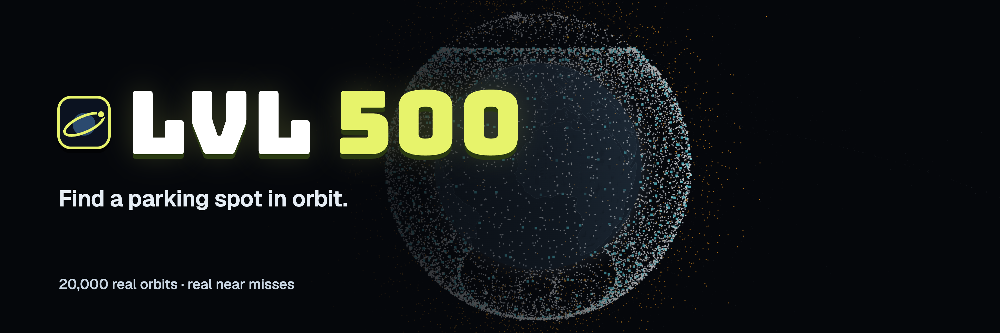
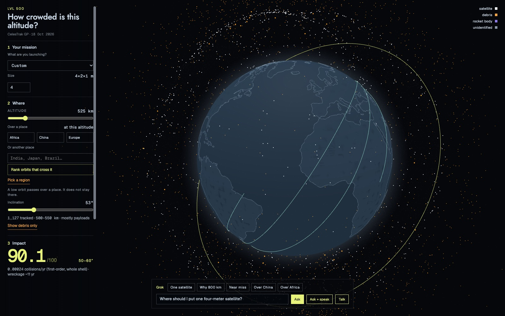
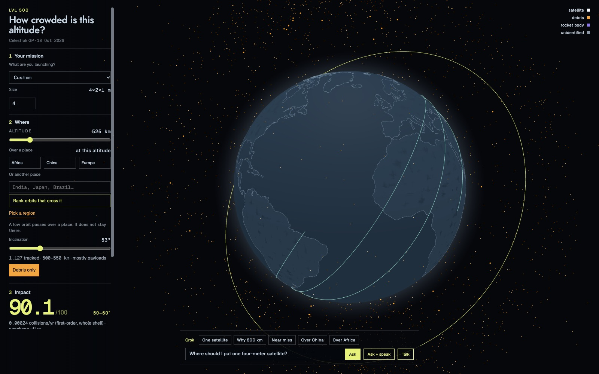
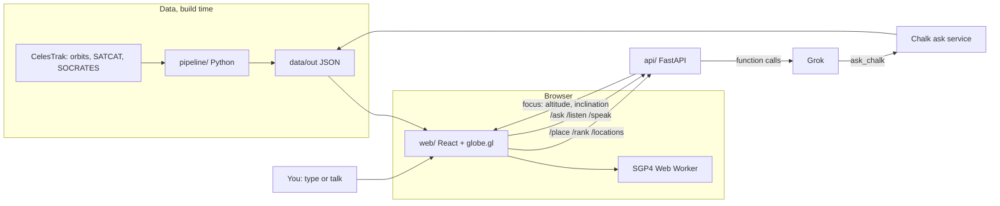
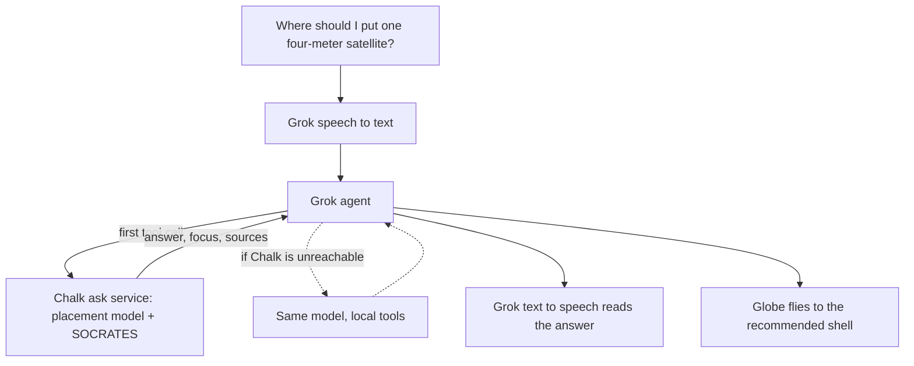

<p align="center">
  
</p>

<h1 align="center">LVL 500</h1>

<p align="center"><b>A parking garage map for orbit.</b><br>
Before you launch, see how crowded your altitude is and how long your wreckage would stay up.</p>

<p align="center">
  Built at <b>HackHarvard 2026</b> &nbsp;·&nbsp; Track: <b>ASUS Sustainability</b> &nbsp;·&nbsp;
  Challenges: <b>SpaceX AI</b>, <b>Best Data-Driven Agent on Chalk</b>
</p>

---

## The problem

**Orbit is an environment, and it is filling up.**

- About **35,000** objects are tracked in Earth orbit, about **29,000** of them below 2,000 km ([CelesTrak SATCAT](https://celestrak.org/satcat/), Oct 2026).
- Starlink satellites made **207,152** collision-avoidance maneuvers from December 2025 to May 2026, up from **148,696** in the six months before, according to SpaceX's reports to the FCC ([Space Intel Report](https://www.spaceintelreport.com/spacex-148696-starlink-collision-maneuvers-in-6-months-ending-nov-30-continued-issues-with-operators-slipshod-reporting/), [n2yo](https://www.n2yo.com/satellite-news/Every-SpaceX-Starlink-satellite-has-to-dodge-a-collision-almost-weekly-and-experts-fear-the-worst/11012)).
- On January 30, 2026, SpaceX asked the FCC for permission to launch up to **1 million** orbital data center satellites ([Engadget](https://www.engadget.com/science/space/spacex-wants-to-launch-a-constellation-of-a-million-satellites-to-power-ai-needs-175607771.html), [Fortune](https://www.fortune.com/2026/02/01/spacex-fcc-approval-filing-data-center-constellation-space-construction-ai)).

Every satellite that dies up there becomes debris someone else has to dodge, and nobody can send a cleanup crew. **Where you park matters more than anything you do after launch**: at 500 km a dead satellite falls out of orbit in about a decade, at 800 km it stays for well over a century.

## What it is

LVL 500 treats orbit like a parking garage. Every altitude is a level. Some levels are packed with working satellites, some are full of junk that won't leave for centuries.

**Say what you're launching → pick a level (or a place to fly over) → see the impact → save and compare**

- **Every tracked object on one globe.** About 20,000 satellites, debris and rocket bodies with public orbits, positioned live with SGP4 and colored by type. Dots far away, 3D models up close.
- **Your mission.** Pick a kind of satellite or a custom size, and how many.
- **Pick a level.** Drag the altitude and inclination. The shell lights up and the Impact card shows a 0 to 100 placement score, expected collisions per year and how long a dead satellite would stay up.
- **Over a place.** Pick Africa, China or Europe, or type a country. A low orbit can't hover over one spot, so LVL 500 ranks the orbit tilts that cross it, quietest debris first, and draws the ground track.
- **Save and compare.** Keep placements side by side.
- **Show debris only.** Hide everything that still works and see where the junk is.
- **Ask Grok.** Type or talk: "Where should I put one four-meter satellite?" Grok calls our tools, answers out loud with real numbers, and the globe flies to the shell it means.
- **Real near misses.** The closest predicted approach this week from SOCRATES. In this snapshot, NuSat-47 is predicted to pass **12 m** from a piece of Fengyun-1C debris at **14.5 km/s** on Oct 22.

Every risk number counts **tracked objects only, so it is a lower bound**. Pieces under about 10 cm aren't tracked.

<p align="center">
  
</p>

## Why orbit is a sustainability problem

**Orbit is a shared resource, and it doesn't clean itself up.** Low down, around 500 km, thin air drags dead objects down within about a decade. Higher up, they can circle for decades or centuries. When two of them collide, they become thousands of new pieces that can hit something else, the cascade known as Kessler syndrome.

**The damage from one bad day lasts a lifetime.** From the CelesTrak catalog we load (Oct 2026):

| Event | Pieces cataloged | Still in orbit today | Typical altitude now |
|---|---|---|---|
| Fengyun-1C, destroyed in a 2007 missile test | 3,531 | **2,311** (65%) | about 830 km |
| Iridium 33 and Cosmos 2251 collide, 2009 | 2,370 | **725** (31%) | about 720 km |

Nineteen years later, two-thirds of the Fengyun-1C cloud is still up there, and one of its pieces is predicted to pass 12 m from a working satellite on Oct 22. ESA's 2026 Space Environment Report models that debris in low Earth orbit would keep growing **even if no one launched anything again**, because the objects already up there keep colliding ([ESA report](https://www.sdo.esoc.esa.int/publications/Space_Environment_Report_I10R0_20260501.pdf), [summary](https://newspaceeconomy.ca/2026/09/17/what-does-esas-new-report-reveal-about-the-risks-facing-satellites/)).

**Earth's sustainability depends on orbit too.** Of the 55 Essential Climate Variables used to track climate change, ESA counts **38** as measured only or mostly from space ([ESA Climate Office](https://climate.esa.int/en/The-climate-challenge)). Sea level, ice sheets and greenhouse gases are watched from the same shells we're filling. A level lost to debris is a level we can't use to watch the planet.

**Prevention is the only cleanup that works today.** No one can sweep up thousands of fragments yet. The cheapest moment to protect orbit is before launch, when an operator picks the level. The FCC agreed in 2022 and cut the deorbit deadline for low-orbit satellites from 25 years to **5 years** after the mission ends ([Via Satellite](https://www.satellitetoday.com/government-military/2022/09/30/fcc-adopts-5-year-rule-for-deorbiting-satellites/)).

### How LVL 500 builds that in

- **The score is 80% long-term harm.** Harm is expected collisions per year times the years a dead satellite stays up, so a quiet but high shell where junk lingers for a century scores badly.
- **Wreckage lifetime is on the Impact card** next to the score, in years, for every placement.
- **Show debris only** makes the problem visible: the junk sits higher than the working satellites.
- **Every number is a lower bound** (tracked objects only), so we never call a level "safe."

Crowding today is only half the story. The other half is **how long your wreckage pollutes that level**.

| One 4×2×1 m satellite at 53° | Score | Wreckage stays up |
|---|---|---|
| 525 km | **90** / 100 | about 11 years |
| 775 km | **47** / 100 | about 168 years |

Same satellite, 250 km higher, and its junk lingers about 15 times longer. Low shells are busier with working satellites, but air drag clears them. Higher shells keep the debris.

**What we don't solve yet:**
- Even the best level here takes about 11 years to clear on its own, longer than the FCC's 5 years. A good level is not a substitute for a deorbit plan.
- Satellites that fall from low shells burn up in the upper atmosphere. Modeling suggests the aluminum oxide they leave behind could slow ozone recovery as megaconstellations grow ([Ferreira et al., *Geophysical Research Letters*, 2024](https://doi.org/10.1029/2024GL109280)). We don't count that cost yet.
- Lifetimes are rule-of-thumb estimates, uncertain by about 10× either way with solar activity and the satellite's shape.

<p align="center">
  
</p>

## How it works

| Piece | What we used it for |
|---|---|
| **CelesTrak** | Orbit elements (OMM) for about 16,750 active satellites and the major debris clouds, the full satellite catalog (35,000+ objects), and SOCRATES predicted close approaches for the next 7 days. |
| **satellite.js (SGP4)** | Positions for every object, in a Web Worker once a second. Checked against a live ISS tracker within about 2 km. |
| **three.js + globe.gl** | The globe. All objects are one GPU point cloud so it stays smooth, with instanced 3D satellite models when you zoom in. Altitude is exaggerated and labeled "not to scale." |
| **Python pipeline** | Turns the catalog into 50 km shells with density, a first-order collision rate and a wreckage lifetime, then scores and ranks placements. |
| **FastAPI** | `/place`, `/rank`, `/locations`, `/close_approaches`, and the agent routes `/ask`, `/listen`, `/speak`, `/imagine`. |
| **Grok** (xAI) | The agent with function calling, Grok Voice (speech in and out) and Grok Imagine. |
| **Chalk** | The ask service Grok calls first, and Agent Evals that test our answers against real data. |
| **Cursor** | Where we built it. |

## Architecture



One question, start to finish:



| Piece | Where |
|---|---|
| Globe, panels, Grok bar | `web/src/App.tsx`, `PlacePanel.tsx`, `AgentPanel.tsx` |
| SGP4 propagation | `web/src/propagate.worker.ts` |
| Home page | `web/src/Home.tsx`, `Stars.tsx` |
| API and the Grok agent | `api/main.py`, `api/agent.py` |
| Chalk client | `api/chalk.py` |
| Chalk ask service and evals | `chalk_tools/` |
| Collision model and scoring | `pipeline/orbit_data.py`, `pipeline/scoring.py` |
| Over a place | `pipeline/locations.py` |

## Sponsors

### ASUS Sustainability track
Space is the next environment we're about to pollute, and the one we watch Earth's climate from. LVL 500 is built around one decision that happens before launch, where to park, and scores it by how long the wreckage would pollute that level, not just by how busy it is today. The full case, with data, is in [Why orbit is a sustainability problem](#why-orbit-is-a-sustainability-problem).

### SpaceX AI (Grok, built in Cursor)
- **Grok agent with function calling** (`api/agent.py`). Every number Grok says comes from a tool call over our data, never from memory. Tools include `place_satellites`, `rank_shells`, `rank_locations`, `get_close_approaches` and `ask_chalk`.
- **Grok Voice.** Speech to text in (`/listen`) and text to speech out (`/speak`), so you can talk to the map.
- **Grok Imagine** (`/imagine`). Illustrates a neighborhood of objects, always labeled as an illustration.
- **Real space data in.** CelesTrak orbits, the satellite catalog and SOCRATES conjunctions.
- **Built in Cursor.**

### Chalk: data-driven agent with evals
- **Ask service on Chalk** (`chalk_tools/ask_app.py`, `ask_core.py`). Grok's first tool call posts the question to a service we deployed on Chalk. It runs our placement model and SOCRATES data and returns `{answer, focus, tool_calls}`. No LLM runs inside it, so answers are repeatable.
- **Agent Evals on Chalk.** Two evaluations, with full method and limits in [`docs/eval_results.md`](docs/eval_results.md).

**1. Does the crowding index steer away from real near misses?** 17 missions from 400 to 1,200 km, SOCRATES as the answer key (1.0 = the shell with the fewest predicted near misses).

| Picker | Mean score |
|---|---|
| Crowding index (`recommend_orbit`) | 0.851 |
| Fewest objects in the same plane | 0.839 |
| Random | 0.505 |

It tracks where predicted near misses cluster (rank correlation 0.71) and beats random in 16 of 17 missions. It does **not** beat simple rules. Our first version counted every orbit that crosses a shell and scored 0.53, and the eval is how we caught it.

**2. Does the ask service give clean, grounded answers?** 58 questions on the same code the live `/ask` uses.

| Check | Result |
|---|---|
| "Where should I put it" answers stay out of the 750 to 850 km debris band, with wreckage under 25 years | 26 / 26 |
| Every number comes from a tool result, the tool arguments or the question | 58 / 58 |
| No "safe" and no invented collision probability | 58 / 58 |

The two evals measure different things. Our score ranks by long-term harm, so it favors low shells where debris clears fast. Low shells are also where this week's near misses cluster (500 to 550 km scores 0.13 on the near-miss key). We'd rather show that tradeoff than hide it.

## The math

**Expected collisions per year** (first-order kinetic-gas model, `pipeline/orbit_data.py`):

$$ \dot{C} = N \cdot n \, v_{\text{rel}} \, \pi \left( \tfrac{L}{2} + r_d \right)^2 \cdot T_{\text{yr}} $$

where $N$ is how many satellites you place, $n$ is the shell's tracked-object density (including the ones you add), $v_{\text{rel}} = 10$ km/s is a typical relative speed, $L$ is the satellite's longest side, $r_d = 0.5$ m is a typical debris radius, and $T_{\text{yr}}$ converts per second to per year.

**Placement score** (`pipeline/scoring.py`), 0 to 100, higher is better:

$$ S = 100 \left( 1 - 0.8\,b_{\text{harm}} - 0.1\,b_{\text{coll}} - 0.1\,b_{\text{dens}} \right) $$

Each $b$ is how bad that factor is (0 best, 1 worst, log scale) compared with other placements. **Harm** is expected collisions per year times the years a dead satellite stays up. The Impact card scores your inclination band within the shell. Lifetimes come from rule-of-thumb decay anchors and are uncertain by about 10× either way.

At very large counts (a million satellites at 900 km gives about 185,000 collisions a year), a first-order model is far outside where it holds. Read those numbers as "don't," not as a forecast.

## Run it locally

Needs [uv](https://docs.astral.sh/uv/) and Node 20+. From the repo root:

```sh
uv sync
uv run python pipeline/fetch_orbits.py      # download orbits, catalog, SOCRATES into data/raw/
uv run python pipeline/build_objects.py     # data/out/objects.json (gitignored, ~14 MB)

cp .env.example .env                        # fill in the keys below
uv run uvicorn api.main:app --port 8000     # API, check http://127.0.0.1:8000/health

cd web && npm ci && npm run dev             # app at http://localhost:5173
```

The other built files (`data/out/*.json`, `web/public/launch_kinds.json`) are committed. To rebuild them after a fresh fetch: `leo_shells.py`, `orbit_data.py`, `build_tools_data.py`, `build_launch_kinds.py` in `pipeline/`.

`.env` (names only): `XAI_API_KEY` for Grok, and `CHALK_ASK_URL`, `CHALK_TOKEN`, `CHALK_ENV_ID` for the Chalk service. Without `XAI_API_KEY` the globe, placement, ranking and near misses still work. Without the Chalk values, Grok uses the same model locally (`/health` shows `"reasoner": "local"`).

```sh
uv run python -m chalk_tools.eval_local         # crowding-index eval, locally
uv run python -m chalk_tools.junk_eval_local    # ask-service eval, locally
uv run --with pytest python -m pytest -q        # tests
```

CelesTrak throttles repeat downloads of the same group for about 2 hours, so `fetch_orbits.py` keeps anything newer than that.

## Repository

```
web/            the app: home page, globe, panels, Grok bar
api/            FastAPI server and the Grok agent
chalk_tools/    Chalk ask service, evals and scorers
pipeline/       data fetch, shells, collision and scoring model
data/out/       built data (objects.json is gitignored)
docs/           API, data, Chalk service and eval write-ups
tests/          tests for the tools, scorers and Chalk wiring
archive/        our first idea (orbital data center carbon payback), kept for reference
```

## Team

Built at HackHarvard 2026 by
- **Candy Xie:** the 3D globe and web app, the four-step mission flow, the original data pipeline, merging everyone's work, and end-to-end QA.
- **David Liu:** the API and the Grok agent (voice, function calling, Imagine), the collision and placement scoring model, and "over a place."
- **Sarah Ling:** the Chalk ask service and the Agent Evals on Chalk, including the eval that caught our wrong first metric.
- **Evan Liu:** the Chalk-first agent flow with local fallback, the globe events that connect answers to the map, saved placements, and the home page.

## Credits

Orbital data from [CelesTrak](https://celestrak.org) (Dr. T.S. Kelso), derived from US Space Force tracking. Land outlines from [Natural Earth](https://www.naturalearthdata.com) (public domain). [satellite.js](https://github.com/shashwatak/satellite-js), [globe.gl](https://github.com/vasturiano/globe.gl), [three.js](https://threejs.org), [skyfield](https://rhodesmill.org/skyfield/) and FastAPI (all MIT). Fonts: Geist, Geist Mono and Jost (SIL OFL). `archive/carbon-payback/espas/`: [ESpaS](https://gitlab.com/sustainable-computing-systems/espas) (MIT / Apache-2.0).

MIT License. See [LICENSE](LICENSE).
